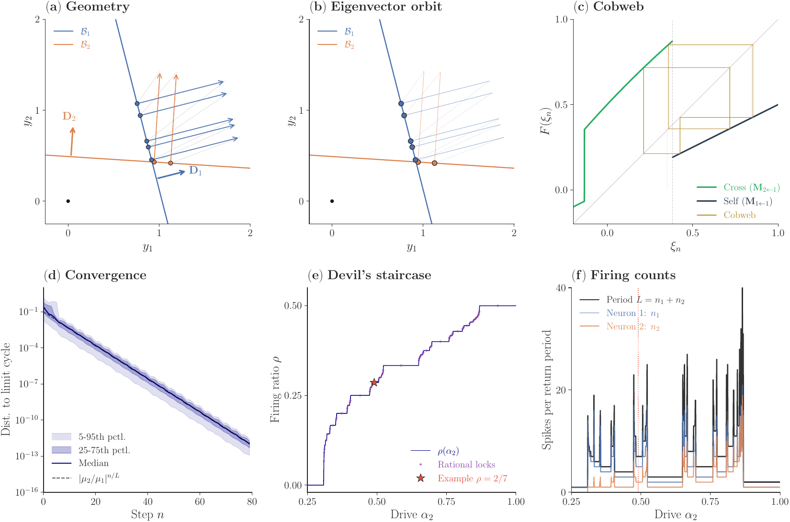
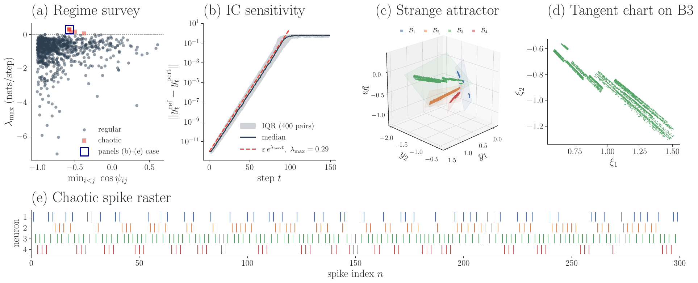
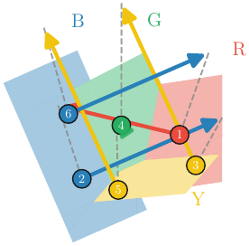
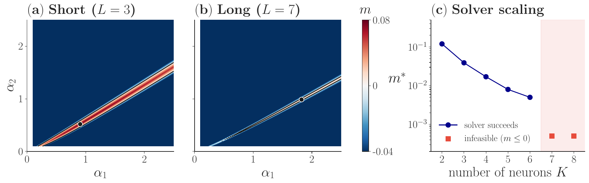
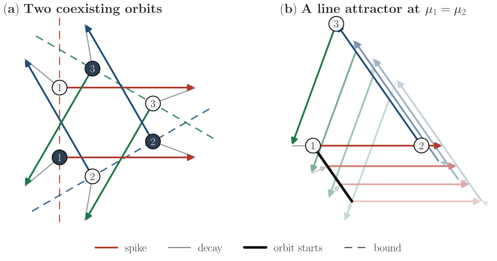

# Spike coding networks as piecewise projective maps

**Closed-form stable periodic firing patterns, and the connectivity that produces them**

Under constant input, the spike-and-decay dynamics of a spike coding network reduce *exactly*
to a piecewise projective map on the spike-bound hyperplanes. Every spike multiplies the state
by one of a finite alphabet of matrices, and every periodic firing pattern is the dominant
eigenvector of the matrix product along its cycle. Whether a sequence is realized, and how fast
the network settles onto it, then follow from one eigendecomposition in the signal dimension
rather than the neuron count.

This repository holds the reference implementation, the inverse-problem solver, one script per
figure, and the LaTeX source of the paper.



*Geometry, the eigenvector orbit, the first-return cobweb, convergence at the predicted rate,
and the devil's staircase relating drive to firing ratio.*

---

## Interactive figures

Several figures are rotatable in the browser. GitHub does not run JavaScript inside a README,
so these open on the project page:

### **[→ Open the interactive figures](https://asagodi.github.io/scn2ppm/)**

| | |
|---|---|
| [Devil's staircase](https://asagodi.github.io/scn2ppm/interactive/devil_slider.html) | two neurons swept across the admissibility window, the firing ratio holding constant over whole intervals of drive (about 33 MB) |
| [Simon sequence RBYGYB](https://asagodi.github.io/scn2ppm/interactive/simon_rbygyb_3d.html) | the period-6 orbit on a four-neuron network, with all four spike bounds |
| [Chirality multistability](https://asagodi.github.io/scn2ppm/interactive/multistability_3d.html) | two period-3 orbits coexisting at one parameter setting |
| [Line attractor](https://asagodi.github.io/scn2ppm/interactive/la_3d_orbit_family.html) | the degenerate case where an isolated orbit becomes a one-parameter family, every point of the black segment starting an orbit with the same firing word |

A tilting-bound view also lives in `interactive_figures/`, along with a per-orbit version of
the line attractor and a decoder-tilt sweep whose analysis is not finished. They are not
served on the project page.

---

## What the figures show

| | |
|---|---|
|  | **One sign decides order or chaos.** With every pairwise decoder cosine positive, so that all recurrent weights are inhibitory, the map preserves a cone and contracts the Hilbert metric: every realized orbit is stable and no trajectory is chaotic. Turn one cosine negative and positive Lyapunov exponents become possible. |
|  | **A prescribed sequence stored as a limit cycle.** Solving the inverse problem for the word RBYGYB gives decoders and drives for which that spike order is an attracting orbit, with an admissibility margin and a contraction ratio saying how robust it is. |
|  | **The inverse problem has a differentiable score.** The admissibility margin is positive exactly when the target word is realized, so the search for connectivity is a smooth optimization rather than a combinatorial one. |
|  | **Several sequences at one parameter setting.** Adding constraints to the same objective gives multistable storage and, in the degenerate limit, a line attractor carrying a continuous variable. |

---

## Quick start

```bash
git clone https://github.com/Asagodi/scn2ppm.git
cd scn2ppm
pip install -r requirements.txt

cd code
python generate_all.py list          # see available targets
python generate_all.py               # regenerate every figure into ../figures/
python generate_all.py fig_overview  # regenerate just one
```

Dependencies are deliberately minimal, see [`requirements.txt`](requirements.txt). Every script
is self-contained: it imports `scn` (and `style` for formatting), builds the system, runs the
analysis, and writes to `../figures/`.

Most scripts finish in under a minute. The exceptions are `fig_combined_noise.py` (a two to
three minute noise scan), `fig_orbit_zoo.py` (five to fifteen minutes), and `fig_basin_map.py`
(about twenty-five minutes on first run, then cached).

---

## The core library

`code/scn.py` is the whole framework in one file:

| | |
|---|---|
| `make_2d_system`, `make_3d_system`, `make_general_system` | decoders, drives, and a tangent frame on each bound |
| `step`, `simulate` | one spike-then-decay step, and forward simulation in continuous time |
| `transition_matrix`, `return_matrix` | the per-pair matrix **M**<sub>j←i</sub> and the return map **M**<sub>σ</sub> for a firing word |
| `eigenvector_orbit` | all orbit points from a single eigendecomposition, given decoders, drives and a word |
| `admissibility_margin` | the continuous score whose positivity means the word is actually realized |
| `get_firing_ratios`, `first_return_B1`, `dist_to_limit_cycle` | rotation number, first-return map, convergence diagnostics |

Everything else is a thin wrapper around these.

---

## Repository layout

```
scn2ppm/
├── code/                 the library and one script per figure
│   ├── scn.py            core: transition matrices, eigenvector orbits, margin
│   ├── style.py          shared matplotlib style
│   ├── generate_all.py   runner, regenerates all figures or one
│   └── fig_*.py          one per figure (figures/README.md maps them)
├── figures/              rendered figure PDFs, and the output directory
├── interactive_figures/  rotatable HTML versions
├── docs/                 the project page served by GitHub Pages
├── posters/              conference posters
└── LICENSE, README.md, requirements.txt
```

The manuscript source is not in this repository. A link to the paper will be added
here when it appears.

---

## Citation

Á. Ságodi, I. Ferreira Pica and W. F. Podlaski, *Spike Coding Networks Are Exactly Solvable:
Periodic Firing Patterns as Eigenvectors.* A full entry with venue will be added when the
paper appears.

## License

MIT, see [LICENSE](LICENSE).
